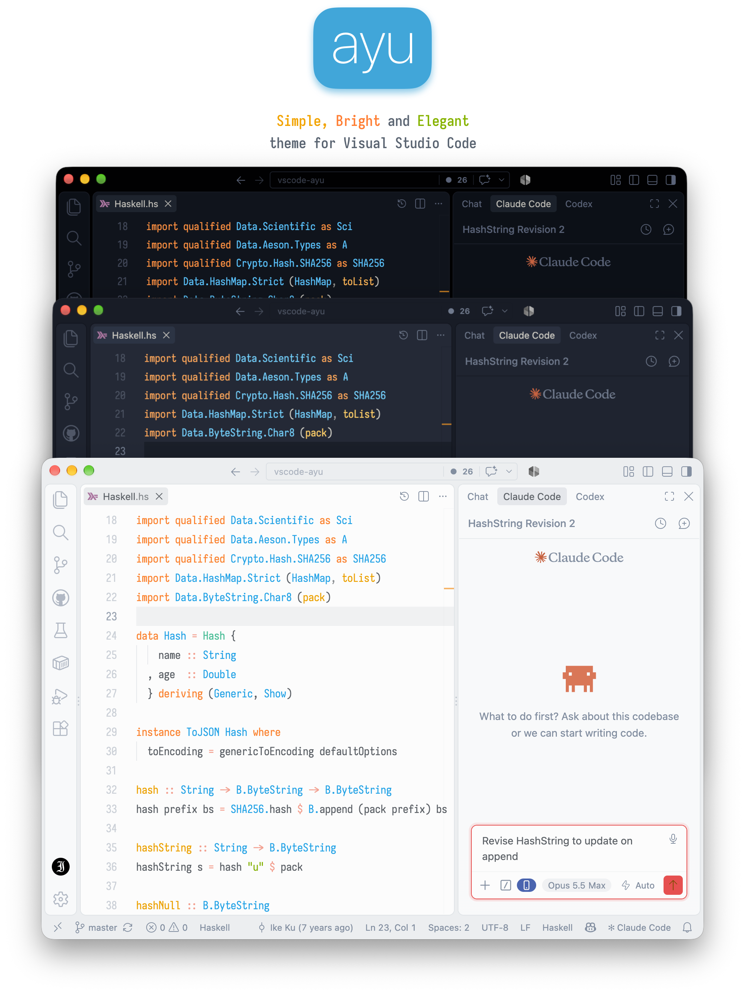
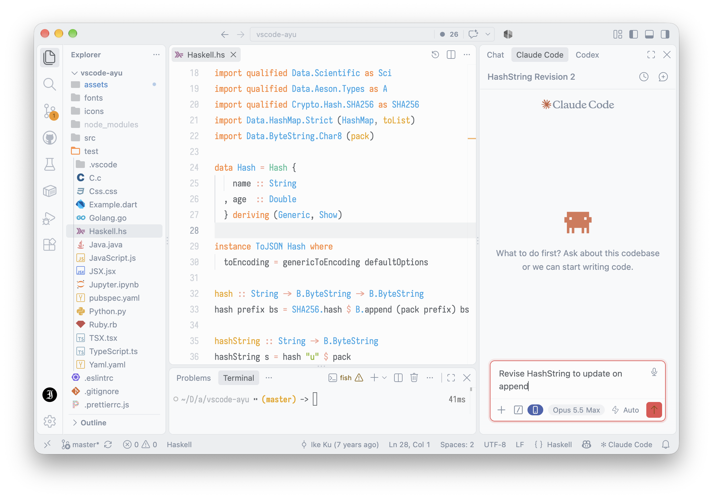
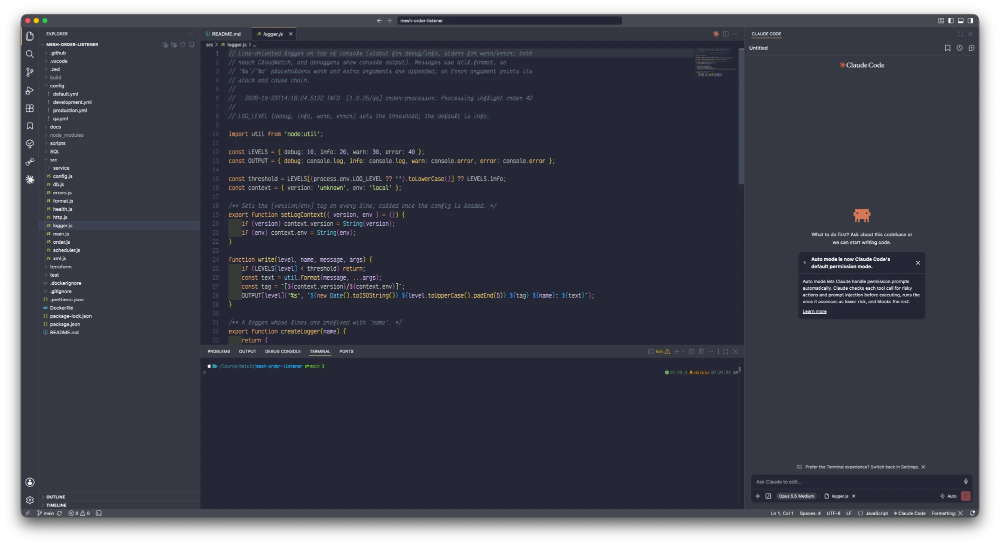

<p align="center">
  
</p>

<p align="center">
  <a href="#install">Install</a> •
  <a href="#screenshots">Screenshots</a> •
  <a href="#credits">Credits</a>
</p>

<p align="center">
  <a href="https://marketplace.visualstudio.com/items?itemName=GregPasquariello.ayu-dawn">
    
  </a>
  <a href="https://marketplace.visualstudio.com/items?itemName=GregPasquariello.ayu-dawn">
    
  </a>
</p>

---

**Ayu Dawn** is a bright color theme based on [ayu](https://github.com/ayu-theme/vscode-ayu). It comes in two versions, _mirage_ and _light_, for comfortable work all day long. Mirage is exactly like Ayu Mirage, but with a slightly paler background and brighter application text and icons, which I find easier on my eyes.

## Install

[Install from the Marketplace](https://marketplace.visualstudio.com/items?itemName=GregPasquariello.ayu-dawn), or run:

```shell
ext install GregPasquariello.ayu-dawn
```

Then go to `Preferences > Color Theme` and select one of the Ayu Dawn variants.

To enable file icons: `Preferences > File Icon Theme > Ayu Dawn`.

### Unbordered themes

Each variant also comes as **Unbordered**: no dividers between the side bar, editor, panel, title bar and status bar, so the whole window reads as one surface. In VS Code's modern UI the panels sit flush instead of floating as separate islands.

## Screenshots

### Light



### Mirage



## What's included

- **4 color themes**: Light and Mirage, each bordered and unbordered, with support for VS Code's modern UI
- **File icons**: Custom icon theme included
- **[Iosevka font](https://github.com/gpasq/vscode-ayu-dawn/tree/master/fonts)**: Bundled for a consistent look

## Credits

Ayu Dawn is a fork of [ayu for VS Code](https://github.com/ayu-theme/vscode-ayu) by teabyii and the ayu contributors, built on the [ayu](https://ayutheme.com) palette by [dempfi](https://github.com/dempfi). Licensed under MIT.
